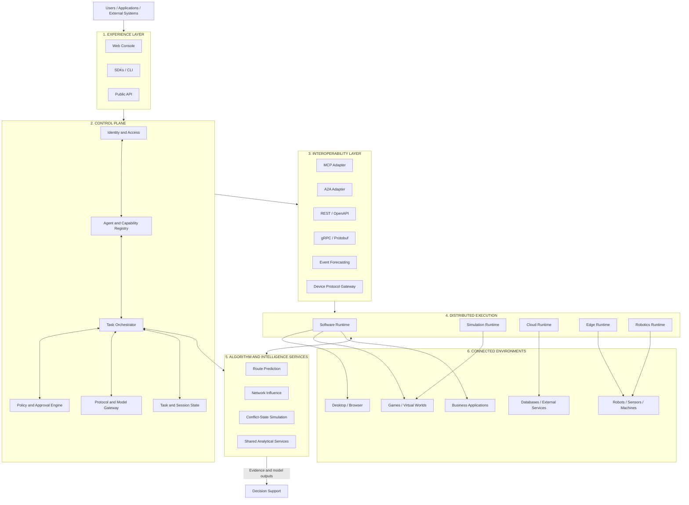
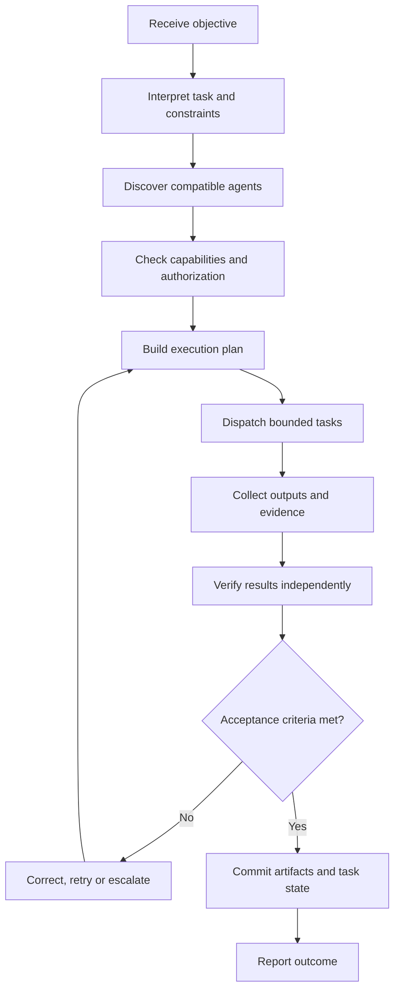
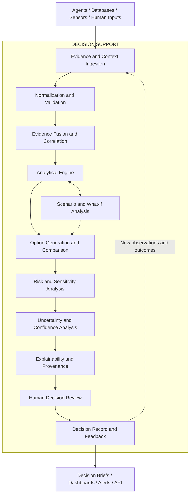

# LAPENZER Agent Fabric and Intelligence Architecture
## Universal AI Interoperability, Orchestration, Algorithm Services and Decision Support Platform

**Document type:** Architecture blueprint  
**Status:** Proposed reference architecture; not a statement that the platform has been implemented or independently validated  
**Product designation:** LAPENZER Agent Fabric (working name)  
**Owner:** LAPENZER  
**Architecture version:** 1.0  
**Last updated:** 5 November 2026

---

## 1. Executive summary

LAPENZER Agent Fabric is a proposed modular platform for connecting, coordinating, governing and observing independently developed AI agents across software applications, cloud infrastructure, local computers, simulations, games, edge devices, robotics and industrial systems.

The platform is built around a **central control plane and distributed execution environments**. The control plane manages identities, agent and capability discovery, task orchestration, policies, approvals, state and observability. Execution runtimes perform work close to the target environment. A standards-based interoperability layer connects heterogeneous agents, tools, applications and devices.

A first-class **Decision Support** module transforms evidence and analytical outputs into traceable decision products. It supports comparison of options, scenario analysis, uncertainty assessment and human review. It does not silently convert a model recommendation into an authorized decision.

The platform is intended to be model-independent, runtime-independent, hardware-independent and deployable as SaaS, in a customer-controlled environment, on-premises, at the edge or in a disconnected network.

This is a target architecture and implementation plan. The components, integrations and deployment profiles described here are proposed capabilities, not claims of completed implementation, certification, operational qualification or predictive performance.

## 2. Product objectives and design principles

1. **Environment independence:** An agent should interact through a defined contract without needing to understand the internal implementation of another agent's environment.
2. **Model independence:** Support commercial model APIs, self-hosted models, local inference and non-LLM agents.
3. **Hardware independence:** Connect physical systems through device-specific adapters and bounded capability interfaces.
4. **Modularity:** Keep modules replaceable and independently testable. Connectors must not require changes to the orchestration core.
5. **Governed execution:** Authenticate agents, authorize individual capabilities, scope credentials and record consequential actions.
6. **Distributed operation:** Support cloud, on-premises, local, edge and disconnected deployments.
7. **Evidence traceability:** Preserve the origin, time, transformations, assumptions and limitations associated with information used by the platform.
8. **Human accountability:** Keep decision authority with designated people or explicitly authorized external processes.
9. **Open integration:** Prefer established, documented standards and portable interfaces over proprietary coupling.
10. **Graceful degradation:** Continue permitted local functions when a remote provider or network connection is unavailable.

## 3. System context and high-level architecture

The system consists of six principal layers and cross-cutting controls.



Security, governance, observability, data management and operational resilience apply across every layer. Algorithm services are independently versioned and deployable, with explicit data contracts, model cards, evaluation records and access policies.

### 3.1 Experience layer

Provides human and machine access:
- Web-based operational console.
- Agent and connector administration.
- Task submission, scheduling and monitoring.
- Workflow visualization and execution history.
- Decision Support workspaces.
- Developer API.
- Python and TypeScript SDKs.
- Command-line interface.
- External application integrations.

The platform must remain operable through APIs and automation without requiring the web console.

### 3.2 Central control plane

The control plane coordinates the platform but is not itself an AI model. It must remain operational if a particular model provider is unavailable.

| Module | Responsibility |
|---|---|
| Agent Registry | Agent identity, versions, ownership, runtime and lifecycle |
| Capability Registry | Machine-readable operations, schemas and requirements |
| Orchestrator | Workflow planning, delegation, coordination and completion |
| Task Scheduler | Queues, priorities, deadlines, retries and concurrency |
| Policy Engine | Contextual authorization and enforcement decisions |
| Approval Manager | Human approvals, rejections, expiry and escalation |
| Model Gateway | Routing to approved hosted or local model providers |
| Protocol Gateway | Protocol translation and endpoint management |
| State Manager | Durable task, workflow and execution state |
| Session Manager | Active sessions and scoped interaction context |
| Connector Manager | Connector installation, configuration, versioning and health |

### 3.3 Interoperability layer

Use adapters to connect systems without embedding their details in the orchestrator.

| Standard / interface | Intended use |
|---|---|
| MCP | Model-to-tool, resource and prompt integration |
| A2A | Discovery and task collaboration between independent agents |
| REST / OpenAPI | Conventional application and partner APIs |
| gRPC / Protobuf | Typed internal service communication |
| WebSockets / SSE | Live bidirectional or streamed updates |
| MQTT | Lightweight IoT and device messaging |
| ROS 2 / DDS | Robotics middleware and distributed robotics communication |
| OPC UA | Industrial interoperability and information modelling |
| Browser / desktop automation | Software environments through controlled adapters |
| Game and simulation adapters | Environment-specific observation and action interfaces |

These technologies solve different problems and are complementary. Each adapter must declare its supported protocol version, authentication model, capabilities, limits and conformance tests.

### 3.4 Distributed execution layer

Five runtime profiles are proposed:

**A. Software Agent Runtime**
- Browser and desktop interaction.
- Business application workflows.
- Software development and testing.
- Database and document operations.
- Controlled operating-system tools.

**B. Simulation Runtime**
- Minecraft and other game environments.
- Digital twins and virtual testbeds.
- Physics and synthetic-data simulations.
- Repeatable scenario execution.

**C. Cloud Runtime**
- Scalable workers and parallel workloads.
- Data processing and model inference.
- Long-running and scheduled tasks.
- Isolated customer workloads.

**D. Edge Runtime**
- Local execution near sensors and devices.
- Intermittent connectivity support.
- Local policy enforcement and event buffering.
- Store-and-forward synchronization.

**E. Robotics Runtime**
- Robotics middleware and device adapters.
- Perception and state interfaces.
- Bounded command execution.
- Device-specific safety interlocks and controller integration.

Every runtime implements a common lifecycle contract: registration, capability declaration, authenticated task reception, execution, status reporting, event publication, artifact exchange, cancellation, error handling and health reporting.

## 4. Universal agent contract

Native agents implement a versioned contract. Third-party systems can use adapters to translate their native interfaces into it.

Required agent metadata:
- Globally unique agent ID.
- Agent and contract version.
- Provider and ownership.
- Runtime type and deployment location.
- Declared capabilities and schemas.
- Required resources and dependencies.
- Authentication identity.
- Permission requirements.
- Health and lifecycle status.
- Trust and software provenance metadata.

A capability declaration is descriptive, not an authorization grant. The policy engine independently evaluates each requested operation.

Example manifest:

```json
{
  "agent_id": "minecraft-builder",
  "version": "1.0.0",
  "runtime": "simulation",
  "capabilities": [
    "world.inspect",
    "structure.plan",
    "block.place",
    "build.verify"
  ],
  "permissions_requested": [
    "world.read",
    "world.write"
  ],
  "execution_limits": {
    "max_execution_time_seconds": 300,
    "human_approval_required": false
  }
}
```

Production manifests should use formal, versioned schemas; signed identity metadata; declared dependencies; policy references; and explicit input/output validation.

## 5. Multi-agent orchestration

The orchestration engine supports:
- Single-agent tasks.
- Sequential workflows.
- Parallel execution.
- Collaborative agent workflows.
- Supervisor and delegate patterns.
- Event-driven activation.
- Human-directed workflows.

Workflow lifecycle:



The orchestrator must handle timeouts, worker crashes, duplicate delivery, idempotency, conflicting outputs, partial completion, cancellation, replacement agents, retries and recovery after restart.

A task completion claim from an agent is not proof of success. Verification must be based on defined acceptance criteria and observable results.

## 6. Decision Support module

Decision Support is a first-class subsystem alongside orchestration. It converts information from agents, external systems, datasets, sensors and human operators into structured, traceable decision products.

### 6.1 Purpose and boundary

The module helps decision-makers understand a situation, assess evidence, compare options, examine uncertainty and document a decision. It supports analysis and recommendation; it does not silently assume decision authority.

Applications may include defence planning support, government analysis, emergency management, infrastructure operations, logistics, research and enterprise management. Any high-consequence use requires domain-specific validation, governance and authorized human oversight.

### 6.2 Internal architecture



### 6.3 Functional components

| Component | Responsibility |
|---|---|
| Evidence ingestion | Ingest structured and unstructured information with source metadata |
| Data validation | Check schema, completeness, freshness, consistency and quality |
| Evidence fusion | Correlate observations while retaining source-level provenance |
| Analytical engine | Run statistical, mathematical, optimization and approved AI models |
| Scenario analysis | Compare alternative assumptions, conditions and possible outcomes |
| Option generation | Identify feasible options against explicit objectives and constraints |
| Risk analysis | Assess likelihood, impact, exposure and dependencies |
| Sensitivity analysis | Show how outputs change when assumptions or inputs vary |
| Uncertainty analysis | Quantify uncertainty, model disagreement and evidence limitations |
| Explainability | Show evidence, transformations, assumptions and model versions behind results |
| Human review | Support review, challenge, approval, rejection and escalation |
| Decision records | Preserve the question, evidence snapshot, alternatives, rationale, approvals and outcome |

### 6.4 Analytical methods

The module should support pluggable methods, selected according to the decision problem:
- Multi-criteria decision analysis (MCDA).
- Bayesian inference and probabilistic reasoning.
- Statistical analysis and forecasting.
- Optimization and resource allocation.
- Scenario modelling and simulation.
- Sensitivity and robustness analysis.
- Risk assessment.
- Evidence reliability assessment.
- Contradiction, anomaly and change detection.
- Alternative comparison and trade-off analysis.
- Post-decision outcome evaluation.

No method should be treated as universally appropriate. The system must record why a method was selected and identify its assumptions and validation status.

### 6.5 Decision workflow

1. Capture the decision question, scope, time horizon and accountable owner.
2. Identify relevant stakeholders, objectives and evaluation criteria.
3. Retrieve evidence and preserve source metadata.
4. Validate quality, freshness, completeness and consistency.
5. Identify missing, conflicting or potentially biased evidence.
6. Run approved analytical models and scenario analyses.
7. Generate feasible options and a baseline or no-action comparison.
8. Compare options against declared criteria.
9. Assess uncertainty, sensitivity, risk and alternative explanations.
10. Present findings with traceable supporting evidence.
11. Obtain required human review and authorization.
12. Preserve the decision record and monitor subsequent outcomes.

### 6.6 Decision product

A decision product should include:
- Decision question and scope.
- Date/time and accountable owner.
- Evidence sources and collection times.
- Data-quality and reliability assessments.
- Observed facts, derived findings and assumptions separately labelled.
- Analytical methods and model versions.
- Options and comparison criteria.
- Expected outcomes and material risks.
- Uncertainty, sensitivity and limitations.
- Recommendation and supporting rationale.
- Dissenting evidence or alternative interpretations.
- Required approvals and final decision.
- Subsequent outcome and review status.

Recommendations must never be presented as established facts. Confidence scores must be defined and calibrated for the specific task; a model's self-reported confidence is not sufficient evidence.

### 6.7 Integration

Decision Support receives information from the Agent Registry, orchestration workflows, research agents, simulation agents, approved data connectors, edge observations and human operators. It returns structured findings to the console, orchestration engine and authorized external systems.

The policy engine governs access to evidence and decision actions. The audit service records data access, model execution, changes, approvals and decision events. Decision Support must not bypass execution permissions or device safety controls.

## 7. Security, governance and safety

Security is a cross-cutting architecture requirement.

### 7.1 Identity and authorization

Proposed controls:
- OIDC/OAuth 2.0 for user and application identity where appropriate.
- Workload identity and short-lived credentials for services.
- SPIFFE-compatible identities where useful.
- Role-based access control (RBAC), attribute-based access control (ABAC) and capability-scoped permissions.
- Policy evaluation through Open Policy Agent (OPA) or an equivalent replaceable policy interface.
- Secrets manager and key-management service.
- Tenant isolation and explicit trust boundaries.
- Credential rotation and revocation.

### 7.2 Execution isolation

- Use OCI-compatible containers for portable workloads.
- Apply resource quotas, filesystem restrictions and network egress controls.
- Use stronger sandboxing for untrusted code and third-party agents.
- Separate control-plane privileges from worker privileges.
- Sign and verify artifacts and runtime images.
- Maintain software bills of materials and dependency scanning.
- Restrict access to host devices and privileged interfaces.

### 7.3 Audit and governance

Maintain append-only, tamper-evident records for:
- Agent identity and version.
- Task and execution identifiers.
- Requested and granted capabilities.
- Policy decisions and approvals.
- Inputs, outputs and artifact references.
- Model and connector versions.
- Errors, retries and overrides.
- Human decisions and subsequent changes.

### 7.4 Physical-system safety

AI agents must not bypass native hardware safety controllers. Physical commands must pass through bounded device gateways and device-specific validation. Emergency-stop functions and safety interlocks must remain independent of the AI runtime. High-consequence actions require appropriate authorization and testing in a controlled environment.

## 8. Data and persistence architecture

Proposed default components:

| Concern | Proposed technology |
|---|---|
| Primary relational store | PostgreSQL |
| Geospatial data | PostGIS where needed |
| Durable messaging | NATS JetStream |
| Cache and ephemeral coordination | Redis |
| Artifact storage | S3-compatible object storage |
| Optional vector retrieval | pgvector or replaceable vector store |
| Service telemetry | OpenTelemetry |
| Policy evaluation | OPA |
| Runtime packaging | OCI containers |

Core entities:
- Organizations and tenants.
- Users, service identities and roles.
- Agents and agent versions.
- Capabilities and schemas.
- Connectors and environments.
- Tasks, workflows, dependencies and execution attempts.
- Approvals and policy decisions.
- Events and audit records.
- Artifacts and provenance.
- Model providers and model configurations.
- Evidence items, analytical runs and decision records.

Use transactional outbox processing, idempotent consumers, durable queues and explicit state transitions. Define retention, deletion, legal hold, data residency and backup policies per deployment profile and customer requirement. Do not store sensitive data in logs by default.

## 9. Deployment profiles

The same modular core should support multiple deployment profiles.

### A. Shared cloud SaaS
- Multi-tenant control plane.
- Tenant-isolated storage and workloads.
- Managed scaling and approved hosted model providers.
- Region-aware data placement and customer-configurable retention.

### B. Dedicated customer environment
- Dedicated services and data stores.
- Customer-controlled network boundaries and keys.
- Private model endpoints and customer-managed integrations.
- Customer-specific policy configuration.

### C. On-premises or disconnected deployment
- Local registry, orchestrator, policy engine, state and audit services.
- Local inference where configured.
- No mandatory external connectivity for local operation.
- Controlled update packages and synchronization.
- Local authorization and cached policy rules with expiry and revocation handling.

### D. Edge deployment
- Lightweight runtime close to devices.
- Local command validation and safety boundaries.
- Store-and-forward event buffering.
- Signed updates and centrally managed configuration when connected.

A disconnected deployment must not depend on a cloud service to authorize every local operation. Local credentials, policy freshness, revocation limits and synchronization conflicts require explicit design.

## 10. API and developer ecosystem

Expose versioned API families:

| API family | Example operations |
|---|---|
| Agent API | Register, update, discover and deactivate |
| Capability API | Publish, inspect and validate |
| Task API | Submit, inspect, cancel, pause and resume |
| Workflow API | Create, delegate and coordinate |
| Execution API | Start, monitor and terminate |
| Connector API | Install, configure, test and revoke |
| Policy API | Evaluate, authorize and inspect decisions |
| Event API | Publish, subscribe and retrieve |
| Artifact API | Upload, retrieve and verify |
| Decision API | Create question, run analysis, compare options, review and record |
| Observability API | Inspect traces, logs and metrics |

Illustrative routes:

```text
POST   /v1/agents
GET    /v1/agents
GET    /v1/agents/{agent_id}/capabilities
POST   /v1/tasks
GET    /v1/tasks/{task_id}
POST   /v1/tasks/{task_id}/cancel
POST   /v1/workflows
GET    /v1/workflows/{workflow_id}
POST   /v1/connectors
POST   /v1/policies/evaluate
POST   /v1/decisions
POST   /v1/decisions/{decision_id}/analyses
GET    /v1/decisions/{decision_id}
POST   /v1/decisions/{decision_id}/review
GET    /v1/executions/{execution_id}/events
```

SDK and tooling priorities:
- Python SDK.
- TypeScript SDK.
- Command-line interface.
- Agent development kit.
- Connector development kit.
- Runtime development kit.
- Decision Support integration kit.

Third-party developers should be able to register an agent and publish a connector without modifying the orchestration core.

## 11. Connector architecture

Every connector is a versioned, independently packaged integration.

A connector manifest declares:
- Connector identity, owner and version.
- Target system and protocol.
- Capabilities and input/output schemas.
- Authentication requirements.
- Requested permissions and network destinations.
- Resource limits and data handling.
- Health checks and error semantics.
- Compatibility and dependency metadata.
- Installation, upgrade, revocation and removal procedures.
- Security test and provenance information.

Connector lifecycle: package → validate → register → review permissions → deploy in isolated runtime → monitor → update or revoke.

## 12. Observability and operations

Use correlated distributed traces, structured logs and metrics across control plane, connectors and runtimes.

Monitor:
- Task acceptance, completion, latency and failure rates.
- Agent availability and health.
- Queue depth and retry rates.
- Model/provider latency and error rates.
- Connector health and protocol failures.
- Resource consumption.
- Authorization denials and approval delays.
- Decision analysis execution and evidence freshness.
- Audit pipeline integrity.

Provide trace IDs and execution IDs in the console and API. Redact secrets and sensitive payloads. Define service-level objectives only after workload measurement and customer requirements are known.

## 13. Technology stack recommendation

These are replaceable defaults, not mandatory dependencies.

| Area | Initial recommendation |
|---|---|
| Web console | React and TypeScript |
| Control-plane API | Python and FastAPI |
| Specialized high-throughput gateways | Go or Rust when justified by profiling |
| API specification | OpenAPI |
| Agent-to-tool | MCP |
| Agent-to-agent | A2A |
| Internal RPC | gRPC and Protobuf |
| Primary database | PostgreSQL |
| Messaging | NATS JetStream |
| Cache | Redis |
| Artifact storage | S3-compatible |
| Optional vector search | pgvector |
| Policy | OPA |
| Observability | OpenTelemetry |
| Packaging | Docker / OCI |
| Large-scale orchestration | Kubernetes where justified |
| Local development | Docker Compose |

Start with a modular monolith for the control plane, clear internal module boundaries, and separately deployable workers and edge runtimes. Split services only when scale, security isolation, independent release cadence or operational ownership justifies it.

## 14. Example end-to-end workflow

A user asks the platform to build and verify a structure in a Minecraft environment.

1. The console submits the objective to the task API.
2. The orchestrator identifies required capabilities.
3. The registry discovers planning, building and verification agents.
4. The policy engine evaluates identities and requested permissions.
5. The orchestrator creates a workflow and assigns bounded tasks.
6. The planning agent produces a structured build plan.
7. The Minecraft connector validates the requested operations.
8. The simulation runtime executes the plan.
9. The verification agent inspects the resulting world state.
10. The orchestrator compares the result against acceptance criteria.
11. If necessary, corrective work is assigned.
12. The platform stores artifacts, logs and the final task record.

A robotics agent may participate in a separate compatible workflow, but it requires its own device adapter, hardware-specific validation and independent safety controls. Shared orchestration does not imply that a simulated action can be transferred directly to physical hardware.

## 15. Implementation roadmap

| Phase | Deliverables | Exit criteria |
|---|---|---|
| 1. Core foundation | Identity, agent registry, capability schemas, task API, durable state | A test agent registers, receives a task and reports a verifiable result |
| 2. Interoperability | MCP, A2A, REST adapters and connector SDK | Independently implemented agents exchange tasks and outputs |
| 3. Multi-agent workflows | Delegation, parallel tasks, shared state and recovery | Multi-agent workflow completes with failure and retry tests |
| 4. Software environments | Browser, desktop and game adapters | Agents operate controlled software and simulation environments |
| 5. Decision Support | Evidence ingestion, analytical runs, option comparison, uncertainty, review and decision records | A decision product can be reconstructed from evidence and model versions |
| 6. Edge and physical systems | Edge runtime, ROS 2 and device adapters | Controlled hardware integration passes device-specific safety tests |
| 7. Enterprise deployment | SaaS, dedicated, on-premises and disconnected profiles | Deployment and recovery tests pass in each supported profile |

## 16. Acceptance and verification requirements

| Requirement | Verification |
|---|---|
| Model independence | Switch model providers without changing orchestration contracts |
| Runtime independence | Execute compatible agents on different hosts |
| Protocol interoperability | Connect independently implemented MCP and A2A agents |
| Connector independence | Add or remove a connector without modifying the core |
| Deployment independence | Deploy the same core to cloud and customer-controlled infrastructure |
| Recovery | Resume or safely fail interrupted tasks without corrupting committed state |
| Authorization | Reject unauthorized operations and expired credentials |
| Tenant isolation | Demonstrate cross-tenant access denial |
| Auditability | Reconstruct task identity, authorization, execution and result |
| Human oversight | Demonstrate configured approval, rejection and escalation |
| Decision traceability | Reproduce an analysis from its evidence snapshot, model version and parameters |
| Uncertainty reporting | Distinguish model uncertainty, data quality and missing evidence |
| Hardware safety | Demonstrate that AI execution cannot bypass independent safety controls |
| Extensibility | Add a new environment through a connector without redesigning the orchestrator |

## 17. Non-goals and design exclusions

- A single monolithic AI agent that performs every function.
- Mandatory dependence on one model provider or cloud vendor.
- A proprietary protocol where an established standard is suitable.
- Direct, unrestricted LLM access to operating systems or physical devices.
- Treating declared capabilities as granted permissions.
- Treating agent-reported completion as verified success.
- Treating model confidence as calibrated probability without validation.
- Assuming continuous internet access.
- Premature decomposition into many microservices.
- Claiming certification, operational qualification or predictive accuracy before the relevant testing has been completed.

## 18. Relationship to LAPENZER NEXUS

Agent Fabric should remain a standalone product with its own APIs, SDKs, deployment profiles and licensing model.

LAPENZER NEXUS may integrate with Agent Fabric to coordinate evidence collection, research, analytical workflows, verification and Decision Support. The integration should use published APIs and capability contracts. Neither product should require the other to operate.

## 19. Final architecture decision

**Product:** LAPENZER Agent Fabric (working designation)  
**Category:** AI agent interoperability, orchestration, execution and decision-support infrastructure  
**Core architecture:** Modular control plane + standards-based interoperability + distributed execution runtimes + first-class Decision Support  
**Deployment:** Shared cloud, dedicated customer environment, on-premises, disconnected and edge  
**Integration:** Versioned APIs, SDKs and third-party connectors  
**Governance:** Identity, capability-based authorization, policy enforcement, human approval, audit and independent hardware safety

The platform's value is the operational layer connecting independently developed agents and environments. It is not another general-purpose chatbot. It is proposed infrastructure for organizations that need to coordinate, govern and observe AI-enabled work across systems they already operate.

## 20. Standards and technical references

Use current versions and verify compatibility during implementation:
- Model Context Protocol: https://modelcontextprotocol.io/
- Agent2Agent protocol: https://a2a-protocol.org/
- OpenAPI Specification: https://spec.openapis.org/oas/latest.html
- gRPC: https://grpc.io/docs/
- ROS 2: https://docs.ros.org/
- OPC Foundation: https://opcfoundation.org/
- Open Policy Agent: https://www.openpolicyagent.org/docs/
- OpenTelemetry: https://opentelemetry.io/docs/
- SPIFFE: https://spiffe.io/docs/
- Kubernetes: https://kubernetes.io/docs/

---
**Document control:** This blueprint describes a proposed target architecture. Implementation status, performance, security assurance, compliance and operational suitability must be established through documented engineering and validation work.
